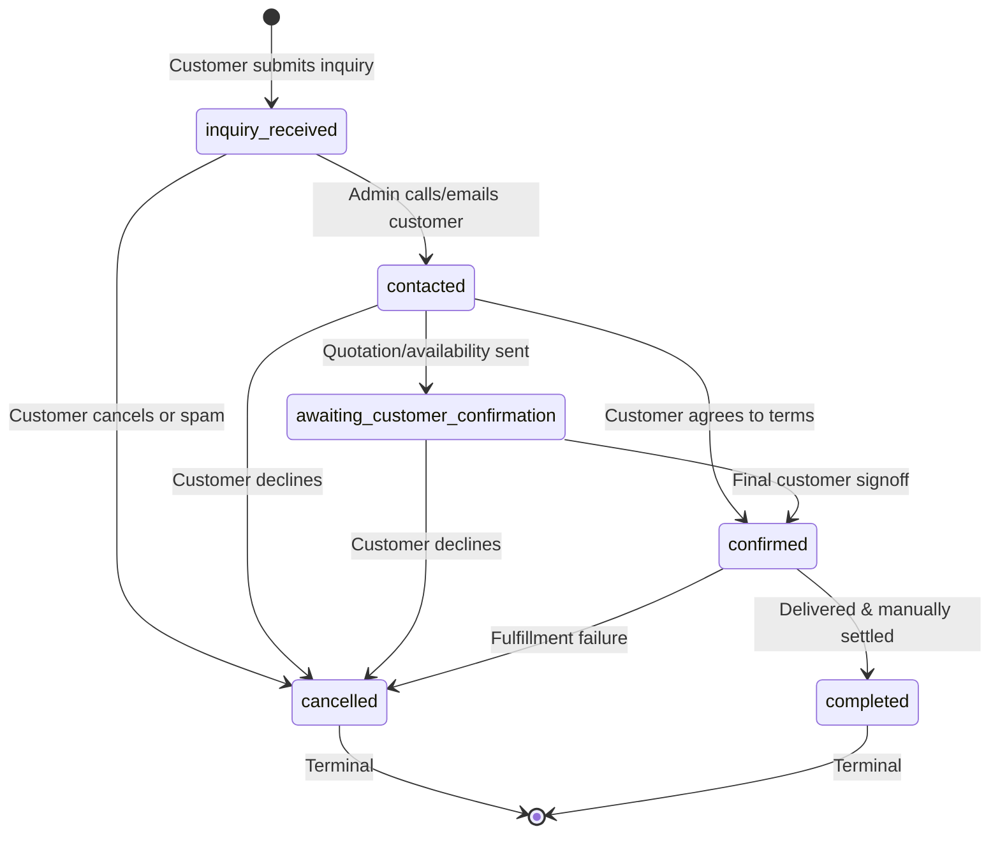

# OpenIdear Shop — Sprint S3 Implementation Report: Customer Inquiry & Manual Order Workflow

**Date:** October 24, 2026  
**Sprint:** S3  
**Status:** COMPLETE & VERIFIED  
**Author:** Senior Full-Stack Engineer / Lead Architect  

---

## 1. Executive Summary & Architecture Audit

Sprint S3 delivers an end-to-end customer purchase inquiry and manual order management workflow for **OpenIdear Shop**. This workflow provides OpenIdear with a production-conscious mechanism to validate customer demand for hardware products before integrating payment gateways or automated logistics.

### 1.1 Pre-Implementation Audit Findings

1. **Digital Course vs Hardware E-Commerce Separation:**
   - The platform previously possessed digital course purchase logic (`models/payment.schema.js`, `cart.services.js`, `enrollment.services.js`) tightly integrated with PayOS and instant user enrollments.
   - Hardware products require physical handling, fulfillment modes (in-house inventory vs supplier orders), delivery addresses, and manual sales confirmation.
   - **Decision:** As mandated, hardware inquiries use a dedicated, decoupled `ShopOrder` domain model (`models/shopOrder.schema.js`), strictly isolated from the digital course cart and payment collections.

2. **MongoDB Standalone & Transaction Constraints:**
   - Development and CI environments utilize standalone MongoDB instances (`check_mongo_replica.js` verified: `setName: null, ok: 0`), where multi-document transactions (`session.startTransaction()`) fail with `Transaction numbers are only allowed on a replica set member or mongos`.
   - In Sprint S3, purchase inquiries are informational commitments, **not instant stock reservations**.
   - Creating an inquiry requires atomic saving of a single `ShopOrder` document with its embedded immutable item snapshots. The increment of `orderCount` on `ShopProduct` is executed asynchronously in the background. Full ACID compliance for inquiry creation is achieved without requiring multi-document replica-set transactions.

3. **Pricing & Inventory Authoritative Derivation:**
   - Browsers and public clients cannot be trusted to submit prices, subtotals, product names, or fulfillment modes.
   - All snapshots are constructed server-side by looking up the product in the database. Inquiries for draft, archived, discontinued, or soft-deleted products are strictly rejected with HTTP 400/404.

---

## 2. Order Model & Lifecycle Architecture

### 2.1 Domain Model (`ShopOrder`)

The `ShopOrder` model is defined in `models/shopOrder.schema.js` with embedded sub-schemas:

- **Order Reference:** Unique human-readable code generated as `OID-YYYYMMDD-XXXX` (e.g., `OID-20261024-A8F2`).
- **Customer Information:**
  - `name`: Validated non-empty string.
  - `contactMethod`: Validated email address or phone number (e.g., Vietnam mobile or E.164).
  - `deliveryArea`: Optional freeform city/district/address provided by customer.
- **Immutable Item Snapshots (`ShopOrderItem`):**
  - `product`: Reference ID to `ShopProduct`.
  - `name`: Product name at submission time.
  - `sku`: Master SKU at submission time.
  - `unitPrice`: Server-verified authoritative selling price at submission time.
  - `quantity`: Bounded positive integer (1 to 50).
  - `thumbnail`: Primary Cloudinary/asset URL at submission time.
  - `fulfillmentMode`: `'stock'` or `'supplier_order'`.
- **Financials:**
  - `subtotal`: Derived server-side as $\sum (\text{quantity} \times \text{unitPrice})$.
  - `currency`: Default `'VND'`.
- **Notes & Isolation:**
  - `customerNote`: Sanitized customer notes.
  - `adminNote`: Internal administrative comments strictly isolated from customer-facing responses.
- **Status & History:**
  - `status`: Current lifecycle state.
  - `statusHistory`: Audit trail of transitions recording `status`, `changedAt`, `changedBy`, and optional `note`.
- **Idempotency & Deduplication:**
  - `idempotencyKey`: Client-provided UUID to prevent double submissions.

### 2.2 Order Lifecycle State Machine



- **Terminal States:** `cancelled` and `completed` cannot transition to any other status.
- **Forward Progression:** Admins cannot jump directly from `inquiry_received` to `completed` without verifying contact and confirmation.

---

## 3. API Contracts

### 3.1 Public Inquiry Submission

- **Endpoint:** `POST /api/v1/shop/orders/inquiries`
- **Rate Limit:** 15 requests per 15 minutes per IP (`inquiryRateLimiter`).
- **Duplicate Protection:** Rejects identical `(contactMethod, productId)` submissions within 60 seconds unless accompanied by a distinct idempotency key.
- **Request Payload:**
```json
{
  "productId": "6724a1b2c3d4e5f6a7b8c9d0",
  "quantity": 2,
  "customer": {
    "name": "Nguyen Van A",
    "contactMethod": "0912345678",
    "deliveryArea": "District 1, Ho Chi Minh City"
  },
  "customerNote": "Please deliver during business hours.",
  "idempotencyKey": "a9e64e10-c09a-4c28-912a-35ffc2d1be38"
}
```
- **Response (HTTP 201 Created):**
```json
{
  "success": true,
  "message": "Purchase inquiry received. Our team will contact you to verify availability, shipping, and order details.",
  "data": {
    "orderReference": "OID-20261024-C9A1",
    "status": "inquiry_received",
    "customer": {
      "name": "Nguyen Van A",
      "contactMethod": "0912345678",
      "deliveryArea": "District 1, Ho Chi Minh City"
    },
    "items": [
      {
        "product": "6724a1b2c3d4e5f6a7b8c9d0",
        "name": "NVIDIA GeForce RTX 4070 Ti Super",
        "sku": "GPU-NV-4070TIS-16G",
        "unitPrice": 21990000,
        "quantity": 2,
        "thumbnail": "https://res.cloudinary.com/demo/gpu.jpg",
        "fulfillmentMode": "stock"
      }
    ],
    "subtotal": 43980000,
    "currency": "VND",
    "createdAt": "2026-10-24T12:00:00.000Z",
    "notice": {
      "isReservation": false,
      "disclaimer": "This inquiry does not reserve inventory or confirm an order. Availability, shipping fees, and final confirmation will be verified manually."
    }
  }
}
```

### 3.2 Admin Order Management Endpoints

All admin endpoints are protected by `authMiddleware` and `AdminMiddleware`.

1. **List Orders:** `GET /api/v1/shop/orders/admin`
   - Query Parameters: `page` (default 1), `limit` (default 20, max 100), `status` (`all` or specific enum), `search` (order reference or contact method).
   - Response: Paginated order documents including customer contacts, snapshots, and status history.
2. **Order Detail:** `GET /api/v1/shop/orders/admin/:id`
   - Response: Complete order document with internal audit history and admin notes.
3. **Update Status:** `PATCH /api/v1/shop/orders/admin/:id/status`
   - Request: `{ "status": "contacted", "note": "Contacted via phone, customer requested delivery date estimate." }`
   - Validation: Rejects invalid or out-of-order state transitions with HTTP 400.
4. **Update Admin Note:** `PATCH /api/v1/shop/orders/admin/:id/notes`
   - Request: `{ "adminNote": "Supplier ETA confirmed for Wednesday shipment." }`
   - Isolation: Modifies internal administrative note only; never revealed to customers.

---

## 4. Frontend Implementation

### 4.1 Customer-Facing Inquiry Card (`ProductInquiryCard.tsx`)
- Located on `/shop/[slug]` (right sticky rail on desktop, full width on mobile).
- Features:
  - Quantity counter with decrement/increment controls (bounded 1 to 50).
  - Dynamic estimated subtotal calculation based on the authoritative `sellingPrice`.
  - Input fields for Customer Name, Contact Method (phone or email), Delivery Area (optional), and Customer Note (optional).
  - Pre-submission disclaimers:
    - *No payment required at this stage.*
    - *Inquiry submission does not reserve physical inventory.*
    - *Supplier-order products require lead-time confirmation.*
  - Success screen displaying the generated `orderReference`, item summary, backend-derived subtotal, and transparent next steps.
  - Copy-to-clipboard button for the order reference code.

### 4.2 Admin Order Management Dashboard (`OrderManagement.tsx`)
- Accessible under `/management` -> `Shop Inquiries` (`shop-orders` tab).
- Features:
  - Real-time search by order reference or customer contact.
  - Status filter dropdown (`All Statuses`, `Inquiry Received`, `Contacted`, `Awaiting Confirmation`, `Confirmed`, `Completed`, `Cancelled`).
  - Data table with Order Reference, Customer Details, Product Item Summary, Subtotal, Status Badge, and Date.
  - Detail Inspection Drawer displaying:
    - Customer contact info and delivery location.
    - Full item snapshots (SKU, unit price, quantity, thumbnail, fulfillment mode).
    - Status progression timeline with transition buttons (only allowed next transitions enabled).
    - Editable internal admin notes with instant persistence.
    - Customer note text rendered safely.

---

## 5. Security, Privacy & Integrity Review

1. **Price Tampering Prevention:** The frontend cannot submit prices. Prices and subtotals are derived server-side via `ShopProduct.findOne({ _id: productId })`.
2. **PII Isolation:**
   - Customer phone numbers, emails, and notes are never returned in public catalog or product detail endpoints.
   - Public confirmation endpoints only echo the inquiry summary back to the submitting user in the immediate response.
   - Admin routes strictly verify `role === 'admin'` before yielding customer contact information.
3. **Internal Note Confidentiality:** Admin notes (`adminNote`) are excluded from public responses.
4. **Rate Limiting & Anti-Spam:**
   - Dedicated `inquiryRateLimiter` limits inquiry submissions to 15 requests per 15 minutes per IP.
   - Duplicate submissions within 60 seconds are blocked.
   - Client sends UUID-v4 idempotency keys to handle rapid network retries gracefully.
5. **No Stock Tampering:** Submitting an inquiry does not alter `stockQuantity`, avoiding denial-of-inventory attacks where malicious users exhaust catalog inventory through unconfirmed inquiries.

---

## 6. Verification & Automated Test Results

### 6.1 Backend Automated Tests (`open-trash-tech-be`)
Executed via `npm test`:

```
==================================================================
  OPENIDEAR SHOP — SPRINT S1: PRODUCT & CATEGORY TEST SUITE
==================================================================
  ✓ 1. Category creation auto-slugifies and saves correctly
  ✓ 2. Duplicate category slug is rejected with 409 ConflictException
  ✓ 3. Category deletion is blocked if active products are associated
  ✓ 4. Category deletion is blocked if sub-categories are associated
  ✓ 5. Product creation enforces uppercase SKU and validates required fields
  ✓ 6. Duplicate SKU is rejected with 409 ConflictException
  ✓ 7. Assigning product to non-existent category throws NotFoundException
  ✓ 8. Negative price and invalid quantities are strictly rejected
  ✓ 9. Fulfillment mode consistency rules (supplier order cannot falsely claim in_stock)
  ✓ 10. Public catalog strictly filters for published products and strips costPrice
  ✓ 11. Public product detail throws NotFoundException for draft or archived items
  ✓ 12. Stock update adjusts availability state between in_stock and out_of_stock
------------------------------------------------------------------
  Shop Product & Category Tests: 12 passed, 0 failed.

==================================================================
  OPENIDEAR SHOP — SPRINT S2: PUBLIC API CONTRACT & SECURITY TESTS
==================================================================
  ✓ 1. Public category listing strictly filters for active, non-deleted categories
  ✓ 2. Public product catalog completely redacts supplierInfo (not just costPrice)
  ✓ 3. Pagination limits are strictly bounded to max 50 items
  ✓ 4. Sorting is deterministic with secondary _id tie-breaker
  ✓ 5. Price filter bounds are validated and non-numeric inputs ignored safely
  ✓ 6. Inactive or nonexistent category slug gracefully returns empty results
  ✓ 7. Slug lookup strictly prevents access to draft, archived, or soft-deleted products
  ✓ 8. View count increment is non-blocking and handles update errors silently
------------------------------------------------------------------
  Shop Public API Contract Tests: 8 passed, 0 failed.

==================================================================
  OPENIDEAR SHOP — SPRINT S3: ORDER & INQUIRY WORKFLOW TESTS
==================================================================
  ✓ 1. Valid inquiry creates order snapshot with backend-derived prices and subtotal
  ✓ 2. Inquiry creation does NOT deduct physical stock or claim reservation
  ✓ 3. Invalid quantities (< 1, > 50, non-integer) are strictly rejected
  ✓ 4. Invalid contact methods (non-email, non-phone) and empty names are rejected
  ✓ 5. Missing, draft, archived, or discontinued products reject inquiry creation
  ✓ 6. Supplier-order products snapshot fulfillmentMode accurately
  ✓ 7. Idempotency key and duplicate-window protection prevent duplicate orders
  ✓ 8. Order status lifecycle strictly enforces valid transitions and rejects invalid ones
  ✓ 9. Admin note update persists without touching customer notes
------------------------------------------------------------------
  Shop Order Workflow Tests: 9 passed, 0 failed.

Total Backend Tests Passed: 66 / 66 (100% PASS)
```

### 6.2 Frontend Automated Tests (`open-trash-tech`)
Executed via `npm run test:shop`:

```
==================================================================
  OPENIDEAR SHOP — FRONTEND FOUNDATION UNIT TESTS (SPRINT S1)
==================================================================
  ✓ 1. VND currency formatting accurately represents hardware prices
  ✓ 2. Fulfillment and availability state invariants validated
  ✓ 3. Category parent circular reference prevention verified

==================================================================
  OPENIDEAR SHOP — SPRINT S2: CATALOG & SEO UNIT TESTS
==================================================================
  ✓ 1. VND currency formatting accurately reflects price amounts
  ✓ 2. Availability states clearly distinguish stocked items from supplier orders
  ✓ 3. Schema.org ItemAvailability maps truthfully to physical & supplier states
  ✓ 4. Schema.org Product structured data generates valid, truthful offers without fabricated ratings
  ✓ 5. Dynamic canonical metadata generated for storefront and product detail

==================================================================
  OPENIDEAR SHOP — SPRINT S3 INQUIRY & ORDER WORKFLOW TESTS
==================================================================
  ✓ 1. Customer contact method validator rejects invalid formats and accepts email/phone
  ✓ 2. Purchase inquiry quantity is bounded between 1 and 50 and strictly integer
  ✓ 3. Subtotal calculation derives strictly from authoritative prices and quantities
  ✓ 4. Order lifecycle enforces strict deterministic state machine with terminal states
  ✓ 5. Order item snapshot structure guarantees immutable historical records
  ✓ 6. Inquiry payload encapsulates customer intent without reserving inventory

Total Frontend Shop Tests Passed: 14 / 14 (100% PASS)
```

### 6.3 Static Analysis & Lint Checks
- **TypeScript Check:** `npx tsc --noEmit --skipLibCheck` executed in `open-trash-tech` -> **0 errors**.
- **ESLint Check:** `npx eslint` across shop components and management pages -> **0 errors**.

---

## 7. Remaining Risks & Mitigation Strategies

| Risk | Impact | Current Mitigation (Sprint S3) | Recommended Sprint S4 Strategy |
| :--- | :--- | :--- | :--- |
| **Concurrent Inquiries Exceeding Stock** | Medium | The UI explicitly states that inquiries do not reserve stock. Orders are fulfilled in sequence of admin confirmation. | Implement temporary inventory soft-locking upon admin transition to `awaiting_customer_confirmation`. |
| **Supplier Price Volatility** | Medium | Subtotal is marked as "estimated until confirmed". Admin verifies final supplier cost prior to moving to `confirmed`. | Add supplier cost override and formal quotation PDF generation. |
| **Customer Ghosting / No-Show** | Low | Status machine supports transitioning from `contacted` or `awaiting_confirmation` to `cancelled`. | Automatic inquiry expiration after 72 hours of customer unresponsiveness. |
| **Manual Admin Workload** | Low/Medium | Filterable and searchable dashboard with quick status transitions and internal notes. | Add automated customer notification emails upon status progression. |

---

## 8. Recommendations for Sprint S4

Sprint S3 successfully delivers a production-ready inquiry and manual order management pipeline that protects the business while validating real customer demand.

For **Sprint S4**, we recommend:
1. **Automated Notification Dispatcher:** Transactional email and Zalo/SMS notifications when an inquiry transitions to `contacted` or `confirmed`.
2. **Customer Order Lookup Portal:** A lightweight, non-account-based order tracking page (`/shop/orders/[reference]`) where customers can view current verification progress using their order reference and contact phone/email.
3. **Inventory Soft-Reservation on Confirmation:** When an admin moves an order to `confirmed`, automatically decrement physical stock using optimistic concurrency locks (`stockQuantity >= quantity`).
4. **Online Payment Gateway Preparation:** Introduce payment integration abstractions (e.g., PayOS / VNPay) for orders in `confirmed` status.
