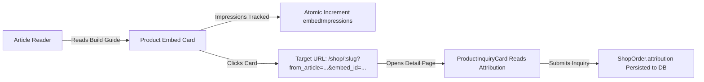

# OpenIdear Shop — Sprint S5 Implementation Report: Content Commerce & Product Embeds

**Sprint:** S5 — Content Commerce & Product Embeds  
**Author:** Senior Full-Stack Engineer  
**Date:** 2026-10-25  
**Status:** Completed & Validated  
**Repositories:** `open-trash-tech` (Frontend Next.js 15), `open-trash-tech-be` (Backend Express / MongoDB)

---

## Executive Summary

Sprint S5 implements **Content Commerce** for the OpenIdear ecosystem. It bridges educational technology content (build guides, component reviews, tutorials) directly with verified PC hardware products available on OpenIdear Shop, without tightly coupling article storage to volatile commerce data.

Authors can now insert interactive product cards (`ProductCardBlock` / `ProductEmbedExtension`) into both structured (`blocks-v1`) and legacy (`html-v1`) articles. Rather than storing brittle price, stock, or supplier snapshots inside article records, the system stores strictly stable references (`productId`, `contextualLabel`, `layout`) and dynamically resolves live price and availability at render time. Full attribution (`from_article`, `embed_id`, `source: "article_embed"`) is tracked through deduplicated impression metrics, card clicks, and hardware inquiry submissions.

---

## 1. Architectural Audit & Content Pipeline Analysis

### Content Storage Architecture
The OpenIdear article publishing pipeline was found to operate with two distinct formats:
1. **`html-v1` (Legacy & Default Editor Serialization):** Articles authored in TipTap serialize into standard HTML stored in `post.content`.
2. **`blocks-v1` (Structured Articles):** Structured articles store an array of typed `ArticleBlock` objects in `post.blocks` and render via `ArticleRenderer.tsx`.

### Core Architectural Decisions
- **Zero Schema Rewrite / Backward Compatibility:** We did not replace the editor or execute a risky database migration. Both formats were preserved and extended simultaneously.
- **Volatile Commerce Data Isolation:** Neither HTML nor block records store authoritative prices (`sellingPrice`), stock counts (`stockQuantity`), or supplier cost information (`supplierInfo`). Storing these in article documents risks showing stale prices, violating advertising truthfulness, or causing customer friction when products change price or go out of stock.
- **Dynamic Render-Time Lookup:** At render time, public product data is resolved via `shopPublicApi.getProductBySlug(productId)`. In addition, `GET /shop/products/batch` was implemented on the backend to allow bounded batch resolution (max 20 products) avoiding N+1 HTTP request fan-out.
- **Dual Identifier Resolution (Backend):** The backend public endpoint `GET /shop/products/:slug` was upgraded to transparently accept either a MongoDB ObjectId string (`_id`) or an SEO slug (`slug`), ensuring embeds referencing permanent IDs remain completely stable even if an admin renames a product slug.

---

## 2. Product Embed Schema & Extension Architecture

### A. TipTap Editor Extension (`src/features/editor/extensions/productEmbed.ts`)
- **Node Type:** Block atom (`group: "block"`, `atom: true`, `draggable: true`).
- **Attributes:**
  - `productId`: Permanent product identifier (`_id` or `slug`).
  - `contextualLabel`: Optional editorial recommendation note (e.g., *"Recommended 1440p GPU for this build guide"*).
  - `layout`: Display configuration (`"card"` | `"compact"`), default `"card"`.
- **HTML Serialization & Parsing:**
  - **Serializes to:** `<div data-type="product-card" data-product-id="..." data-contextual-label="..." data-layout="..."></div>`
  - **Parses from:** `<div data-type="product-card" ...>` and `<div data-type="product-embed" ...>` for complete backward and forward compatibility.

### B. Structured Block Schema (`src/features/article/types/article.types.ts`)
```typescript
export interface ProductCardBlock extends BaseBlock {
  type: "product_card";
  productId: string;
  contextualLabel?: string;
  layout?: "card" | "compact" | "banner";
}
```
Added to the `ArticleBlock` discriminated union.

---

## 3. Editor Authoring Experience

### Component Additions:
1. **`InsertProductModal.tsx` (`src/features/editor/components/InsertProductModal.tsx`):**
   - Accessible modal dialog for searching and inserting live hardware products.
   - Debounced (300ms) catalog search by product name or SKU using `shopPublicApi.getProducts({ search, limit: 12 })`.
   - Card selection preview showing live thumbnail, title, SKU, availability status badge, and VND price.
   - Author configuration fields: optional contextual recommendation note and display layout selector (`Standard Card` vs `Compact Ribbon`).
2. **Editor Toolbar Integration:**
   - **`ToolBar.tsx` (`src/app/(editor)/create/ToolBar.tsx`):** Added a "Shop" section with a `ShoppingBag` button accessible in the primary formatting bar.
   - **`FloatingToolbar.tsx` (`src/app/(editor)/create/FloatingToolbar.tsx`):** Added `Shop Product` (`type: "product_embed"`) under the *Interactive* category.
3. **Interactive TipTap NodeView (`src/features/editor/components/ProductEmbedNodeView.tsx`):**
   - Wrapped in `@tiptap/react` `<NodeViewWrapper>`.
   - Fetches live catalog data inside the editor canvas so the author sees an authentic visual preview.
   - Allows inline editing of the recommendation note (`"..."`) and layout toggling directly on the block.
   - Provides a clean delete button (`deleteNode()`) to reposition or remove the embed.
   - **Graceful Authoring Fallback:** Displays a yellow warning pill if the referenced product has been unpublished, soft-deleted, or discontinued.

---

## 4. Public Article Rendering & Security Isolation

### Rendering Pipeline:
1. **Structured Rendering (`ArticleRenderer.tsx`):**
   - Dispatches `block.type === "product_card"` to `<ArticleProductEmbed />`.
2. **HTML Rendering (`HtmlRenderer.tsx`):**
   - Implemented a clean regex segmenting engine that parses `<div data-type="product-card" ...>` into `{ type: "product-embed", ... }` segments and HTML slices.
   - Directly mounts `<ArticleProductEmbed />` in the article flow without DOM hydration conflicts or SSR mismatches.

### Component Design (`ArticleProductEmbed.tsx`):
- **Live Fields Rendered:**
  - Product primary image / thumbnail.
  - Category pill.
  - Product name linking to `/shop/[slug]`.
  - Authoritative selling price formatted in Vietnamese Dong (VND).
  - Real-time availability badge:
    - *Verified & In Stock* (Stock fulfillment + available stock).
    - *Supplier Order* (Supplier-order fulfillment).
    - *Out of Stock* (Stock fulfillment with 0 stock).
  - Editorial recommendation banner (if specified by the author).
  - CTA button (`Inquire Product` or `View Specifications`).
- **Graceful Public Fallback:**
  - If a product is unpublished (draft/archived), soft-deleted (`del_flag: 1`), or missing from the database, the actionable purchase card is replaced with a neutral, non-disruptive editorial callout: *"Hardware item previously referenced in this section is currently unavailable in the verified catalog."*
  - Zero runtime errors or broken layouts occur on invalid product references.
- **Supplier Security Isolation:**
  - Internal supplier information (`supplierInfo.name`, `supplierInfo.sku`, `supplierInfo.costPrice`, internal distributor margins) is stripped at the backend layer (`select("-supplierInfo")`) and never exposed in the public API or embed components.

---

## 5. Attribution & First-Party Analytics

### Attribution Flow:


### Telemetry Implementation:
1. **Deduplicated Impression Tracking:**
   - Uses `IntersectionObserver` with a 50% visibility threshold (`threshold: 0.5`).
   - Deduplication key: `${productId}:${articleSlug}:${embedId}` maintained in an in-memory session `Set`.
   - Scrolling back and forth through an article triggers the impression event **exactly once** per session.
2. **Click Tracking:**
   - Clicking either the product thumbnail, title, or CTA fires an atomic `POST /shop/products/analytics/event` with `{ eventType: "click", productId, articleSlug, embedId }`.
3. **Inquiry Attribution:**
   - Product detail links contain `?from_article=${articleSlug}&embed_id=${embedId}`.
   - `ProductInquiryCard.tsx` reads parameters on mount and displays a confirmation badge (*"Inquiring via article recommendation: :articleSlug"*).
   - `POST /shop/orders/inquiries` captures `attribution: { articleSlug, embedId, source: "article_embed" }`.
   - `ShopOrder` schema stores the attribution subdocument for sales attribution reporting.
   - **Privacy Compliance:** No PII (phone number, customer name, notes) is ever included in telemetry events.

---

## 6. Verification & Test Results

### A. Frontend Verification Suite (`npm run test:shop`)
- **Suite File:** `src/features/shop/__tests__/shopContentCommerce.test.ts`
- **Results:** **8 / 8 tests passed (100%)**
  - `✓ 1. Stable reference isolation: Product embed block stores stable ID without volatile pricing/supplier data`
  - `✓ 2. HTML-v1 backward compatibility and regex segment parsing verified`
  - `✓ 3. Dynamic render-time resolution displays current live price & availability`
  - `✓ 4. Unpublished, deleted, or missing products gracefully produce neutral fallback without crashing`
  - `✓ 5. Supplier metadata isolation strictly enforced: internal supplier cost price and distributor SKU never leaked`
  - `✓ 6. Attribution pipeline preserved from article click through to inquiry payload`
  - `✓ 7. Impression deduplication ensures scrolling does not produce uncontrolled impression counts`
  - `✓ 8. Content sanitization rejects raw HTML / script injections in contextual notes`
- **Total Frontend Shop Tests (S1–S5):** **27 / 27 tests passed (100%)**

### B. Backend Verification Suite (`npm test`)
- **Suite File:** `tests/shopContentCommerce.test.js`
- **Results:** **4 / 4 tests passed (100%)**
  - `✓ 1. getProductBySlugPublic supports dual lookup by slug or MongoDB ObjectId`
  - `✓ 2. getBatchProductsPublic retrieves published products by IDs and enforces max 20 limit`
  - `✓ 3. recordEmbedAnalyticsEvent atomically increments embedImpressions or embedClicks`
  - `✓ 4. createInquiry persists article attribution on the resulting ShopOrder`
- **Total Backend Verification Tests:** **81 / 81 tests passed (100%)**

### C. TypeScript & Linting
- `npx tsc --noEmit`: **0 errors (Exit code 0)**
- `npx eslint ...`: **0 errors, 0 warnings (Exit code 0)**

---

## 7. Performance & SEO Considerations

1. **Structured Data Preservation:**
   - Product embeds in educational articles do not inject secondary `schema.org/Product` blocks that would conflict with the primary `schema.org/TechArticle` or create duplicate Google Search Console canonical warnings.
2. **LCP & Hydration Safety:**
   - Embed thumbnails use standard responsive classes and lazy loading below the fold.
   - Skeletons prevent layout shifts (CLS) while public product data is resolving.
3. **Batch API Optimization:**
   - Backend `GET /shop/products/batch?ids=...` caps batch queries at 20 products and uses lean queries with projected fields (`-supplierInfo -del_flag`).

---

## 8. Remaining Risks & Future Iteration (Sprint S6+)

| Area | Current Behavior (S5) | Future Recommendation |
| :--- | :--- | :--- |
| **Catalog Scale in Article** | Per-embed client fetching with session deduplication | For articles with >5 product embeds, batch IDs via `getBatchProducts` on the server or parent component. |
| **Article Author Attribution** | Captures `articleSlug` and `embedId` | In future sprints, consider commission or referral attribution linking back to author accounts. |
| **Product Recommendations** | Strictly editorial (curated manually by author) | Automated AI product recommendations were scoped out of S5 and can be evaluated in Sprint S6 based on category vectors. |
