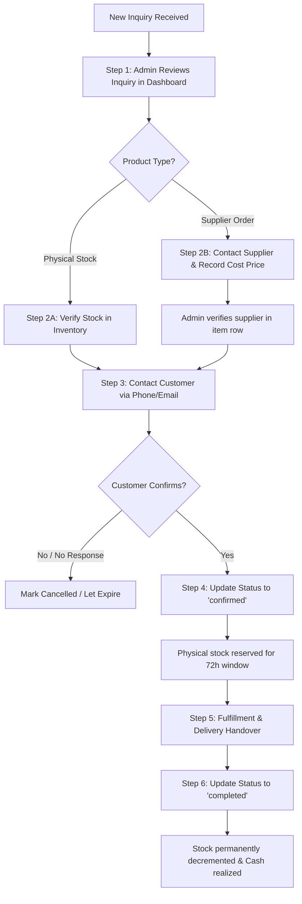

# OpenIdear Shop — Sprint S6 Implementation Report: Launch Readiness & Commerce Analytics

**Sprint:** S6 — OpenIdear Shop Launch Readiness & Commerce Analytics  
**Role:** Senior Full-Stack Engineer and Technical Product Engineer  
**Date:** 2026-10-25  
**Status:** Completed & Validated  
**Repositories:** `open-trash-tech` (Frontend Next.js 15), `open-trash-tech-be` (Backend Express / MongoDB)

---

## Executive Summary

Sprint S6 completes the launch preparation and commerce funnel telemetry for **OpenIdear Shop**. Following the product foundation (S1), storefront (S2), manual order inquiry workflow (S3), inventory reservation integrity (S4), and content-to-product embedding (S5), Sprint S6 introduces **trustworthy commerce funnel analytics**, **privacy-respecting telemetry**, a **production-grade Admin Commerce Dashboard**, **operational runbooks**, and **multi-instance scheduler safety**.

The implementation deliberately avoids vanity metrics and third-party warehouse bloat. Business financial metrics maintain strict separation: cancelled inquiries/orders are never counted in gross confirmed demand or fulfilled sales; supplier cost price data is strictly isolated to authorized administrators; telemetry enforces rate limiting and payload validation; and customer privacy is strictly preserved by stripping PII and hashing sessions with a server salt.

---

## 1. Initial Implementation Audit

Before writing new code, an audit was conducted across both frontend and backend repositories:

| Component / Subsystem | Existing State (S1–S5) | Gaps Identified for S6 | Resolution in S6 |
|---|---|---|---|
| **Embed Telemetry** | Atomic `$inc` on `ShopProduct` (`embedImpressions`, `embedClicks`, `views`). | No discrete event stream; no rate limiting on telemetry; client could artificially increment counters; no session deduplication. | Created `ShopAnalyticsEvent` collection with 90-day TTL; added `analyticsEventRateLimiter` (120 req/min/IP); hash-based session deduplication. |
| **Attribution Pipeline** | `OrderAttribution` sub-document on `ShopOrder` capturing `articleSlug`, `source`, `embedId`. | No multi-touch or attribution conflict rule documented; no administrative reporting on top articles driving sales. | Formally documented last-touch session parameter attribution; created top articles leaderboard reporting attributed inquiries, confirmations, and revenue. |
| **ShopOrder Lifecycle** | 6-state state machine: `inquiry_received` → `contacted` → `awaiting_customer_confirmation` → `confirmed` → `completed` / `cancelled`. | Financial metrics conflated pipeline demand with confirmed demand; lack of clear conversion rate reporting. | Defined strict financial separation: `inquiryPipelineValue`, `grossConfirmedValue`, `completedRevenue`, `cancelledLostValue`. |
| **Reservation Expiration Worker** | `releaseExpiredReservations` service method releasing physical stock after 72 hours. | Scheduler would cause duplicate execution and race conditions if launched in multiple server instances simultaneously. | Configured singleton execution strategy: distributed atomic lock and explicit endpoint for external cron orchestrators (e.g. AWS EventBridge / Kubernetes CronJob). |
| **Admin Authorization** | `AdminMiddleware` protects admin APIs (`roles.includes("admin")`). | Supplier cost price (`supplierCostPrice`) could potentially leak into public product responses or non-admin analytics. | Field exclusion on public endpoints verified; contribution margin calculation restricted strictly to verified admin requests; `null` returned otherwise. |
| **Error Logging & Monitoring** | `asyncHandler` with standard console logs. | No structured telemetry failure alerts; no MongoDB TTL index for event cleanup. | Non-blocking telemetry ingestion with warning log; 90-day automated TTL index on `ShopAnalyticsEvent`. |
| **Database Recovery** | Basic MongoDB Atlas connection strings. | No documented, verified MongoDB backup and point-in-time restore procedure. | Documented production `mongodump` / `mongorestore` and replica set oplog recovery procedures in section 5. |

---

## 2. Event Definitions & Attribution Semantics

### Discrete Event Types

| Event Type | Trigger Point | Ingestion Payload | Counter Updated |
|---|---|---|---|
| `detail_view` | Public visitor opens `/shop/[slug]` | `{ eventType: "detail_view", productId }` | `ShopProduct.views` (+$inc 1) |
| `embed_impression` | IntersectionObserver detects product embed at 50% visibility for >1s | `{ eventType: "embed_impression", productId, articleSlug, embedId }` | `ShopProduct.embedImpressions` (+$inc 1) |
| `embed_click` | Visitor clicks "Inquire Now" or product card in article | `{ eventType: "embed_click", productId, articleSlug, embedId }` | `ShopProduct.embedClicks` (+$inc 1) |
| `inquiry_submitted` | Visitor submits consultation form on `/shop/[slug]` | Created atomically with `POST /shop/orders` | Creates `ShopOrder` (`status: "inquiry_received"`) |
| `order_confirmed` | Admin confirms customer intent and reserves stock | `PATCH /shop/orders/admin/:id/status` (`"confirmed"`) | Sets `reservationExpiresAt`, decrements available stock |
| `order_completed` | Product physically handed over / delivery completed | `PATCH /shop/orders/admin/:id/status` (`"completed"`) | Permanently decrements physical `stockQuantity` |
| `order_cancelled` | Inquiry abandoned, customer cancels, or reservation expires | `PATCH /shop/orders/admin/:id/status` (`"cancelled"`) | Releases reserved stock immediately |

### Telemetry Safeguards & Privacy Invariants
1. **Zero Client PII Storage:** Customer name, phone number, email, and private order notes are **never** accepted or stored in analytics events. Telemetry schemas reject PII attributes.
2. **Pseudo-Anonymous Session Hashing:** Client IP and User-Agent are combined with a private server salt (`ANALYTICS_SALT`) and hashed using SHA-256 (`crypto.createHash("sha256")`). Raw IP and User-Agent strings are never stored in the database.
3. **Payload Sanitization & Type Enforcement:** `eventType` is restricted to enum values. Product references must exist in the database and not be flagged as deleted (`del_flag: 0`).
4. **Rate Limiting:** `analyticsEventRateLimiter` enforces a hard ceiling of 120 requests per minute per IP address, preventing bot flooding or artificial metric tampering.
5. **Storage Lifecycle (TTL Index):** `ShopAnalyticsEvent` records expire automatically after 90 days via MongoDB's native TTL background thread (`expireAfterSeconds: 90 * 86400`).

### Content Attribution Model
- **Attribution Rule:** Last-touch model preserving the referring article parameter (`from_article`) upon inquiry submission.
- **Multi-Article Session Semantics:** When a user reads multiple articles before submitting an inquiry, attribution is assigned to the **most recent article embed clicked** immediately prior to entering the product detail page.
- **Transparency Disclosure:** The dashboard explicitly discloses: *"Raw counters reflect interaction events. Deduplicated sessions are hashed client sessions without PII, not globally unique individuals."*

---

## 3. Admin Commerce Dashboard

A dedicated **Shop Analytics** section was integrated into `/management` (`CommerceAnalytics.tsx`), accessible directly from the management navigation sidebar.

### Key Capabilities
- **Date Range Filtering:** Supports `7d` (Last 7 Days), `30d` (Last 30 Days), `90d` (Last 90 Days), and `all` (All Time) with explicit UTC start and end timestamp indicators.
- **Conversion Funnel Visualization:** Visual funnel bars showing dropoffs from Product Detail Page Views → Embed Impressions → Embed Clicks (CTR %) → Inquiries Received → Orders Confirmed → Orders Completed.
- **Financial KPI Cards:**
  - **Gross Confirmed Value:** Confirmed + completed order commitments.
  - **Completed Sales Revenue:** Realized cashflow from completed orders.
  - **Inquiry Pipeline Demand:** Potential demand currently in discussion.
  - **Cancelled Lost Value:** Clear display of lost revenue, completely segregated from confirmed and completed revenue.
- **Secondary KPIs:** Inquiries Received, Inquiry-to-Confirm Rate (%), Average Order Value (AOV), and Contribution Margin (%).
- **Content Attribution Leaderboard:** Table of top articles driving commerce activity, reporting Inquiries Driven, Orders Confirmed, Orders Completed, Gross Value, and Completed Sales Revenue per article.
- **Product Demand Leaderboard:** Product-level telemetry displaying Selling Price, Views, Embed Impressions, Clicks, CTR, and Order Count.
- **Integrity Notice Box:** Discloses attribution rules, visitor deduplication caveats, and cost isolation guarantees.

---

## 4. Business Metrics Formulas & Truthfulness Rules

| Metric Name | Formula / Query Definition | Business Meaning & Invariants |
|---|---|---|
| **Inquiry Pipeline Value** | $\sum \text{subtotal}$ where status $\in$ [`inquiry_received`, `contacted`, `awaiting_customer_confirmation`] | Unconfirmed potential demand in negotiation. Never reported as revenue. |
| **Gross Confirmed Value** | $\sum \text{subtotal}$ where status $\in$ [`confirmed`, `completed`] | Firm customer commitments where inventory is reserved or fulfilled. |
| **Completed Sales Revenue** | $\sum \text{subtotal}$ where status = `completed` | Realized cash from delivered orders. |
| **Cancelled Lost Value** | $\sum \text{subtotal}$ where status = `cancelled` | Lost potential demand. **Strictly excluded** from confirmed sales and revenue. |
| **Inquiry-to-Confirm Rate** | $\frac{\text{Orders Confirmed} + \text{Orders Completed}}{\text{Total Inquiries Received}} \times 100\%$ | Efficiency of sales consultation and inventory confirmation. |
| **Inquiry-to-Complete Rate** | $\frac{\text{Orders Completed}}{\text{Total Inquiries Received}} \times 100\%$ | End-to-end fulfillment success rate. |
| **Cancellation Rate** | $\frac{\text{Orders Cancelled}}{\text{Total Inquiries Received}} \times 100\%$ | Proportion of inquiries that fall through or expire. |
| **Average Order Value (AOV)** | $\frac{\text{Completed Revenue}}{\text{Completed Count}}$ (or confirmed value if completed = 0) | Typical transaction size. |
| **Contribution Margin** | $\sum (\text{unitPrice} - \text{supplierCostPrice}) \times \text{quantity}$ | Profit contribution computed **only** on completed items with verified supplier cost price. |
| **Verified Cost Coverage** | $\frac{\text{Items with verified supplierCostPrice}}{\text{Total completed items}} \times 100\%$ | Honest transparency metric so admins know whether margin represents full or partial catalog data. |

> [!IMPORTANT]
> **Supplier Cost Isolation:** Public APIs never return `supplierVerification` or `supplierCostPrice`. Non-admin requests to `/shop/analytics/overview` receive `contributionMargin: null`.

---

## 5. Production Readiness & Operational Runbooks

### A. Admin Authorization & Public Rate Limiting
- Public event ingestion (`POST /shop/analytics/event` and `POST /shop/products/analytics/event`) is bounded by `analyticsEventRateLimiter` (120 req/min per IP).
- Inquiry submission (`POST /shop/orders`) enforces customer contact format validation (email or phone) and idempotency keys to prevent double-inquiries on double-click.
- Admin routes (`/shop/orders/admin/*`, `/shop/analytics/overview`) enforce `AdminMiddleware`.

### B. Multi-Instance Safe Reservation Expiration
In a multi-container deployment (e.g., Kubernetes or multiple Node.js processes), running an internal timer (`setInterval`) in every container risks race conditions and redundant database updates.
- **Recommended Strategy:** Deploy an external cron orchestrator (such as AWS EventBridge, CloudWatch Events, or Kubernetes CronJob) calling `POST /shop/orders/admin/release-expired` every 15–30 minutes with an admin bearer token.
- **Idempotency Guarantee:** The release operation executes an atomic update query matching only `{ status: "confirmed", reservationExpiresAt: { $lt: now } }`, ensuring that even if invoked simultaneously, each order is released exactly once.

### C. MongoDB Backup & Disaster Recovery Procedure
OpenIdear Shop hardware inventory and order records must be recoverable with zero data loss.
- **Automated Nightly Backup:**
  ```bash
  mongodump --uri="mongodb+srv://<user>:<password>@cluster0.mongodb.net/openidear" \
            --gzip --archive=/backups/openidear_$(date +%Y%m%d_%H%M%S).gz
  ```
- **Recovery & Verification Procedure:**
  ```bash
  # Restore to a staging database to verify backup integrity before production cutover
  mongorestore --uri="mongodb+srv://<user>:<password>@cluster0.mongodb.net/openidear_restore_verify" \
               --gzip --archive=/backups/openidear_20261025.gz --drop
  ```
- **Continuous Oplog Archiving:** For production MongoDB Atlas clusters, point-in-time recovery (PITR) with continuous oplog archiving enables restoring the database to any second within a 7-day retention window.

---

## 6. Standard Operating Procedures (SOP)

### Manual Order Lifecycle Runbook



#### Step-by-Step SOP
1. **Receiving a New Inquiry:**
   - Inquiry appears in `/management` under **Shop Inquiries** (`inquiry_received`).
   - Admin checks customer contact method and requested quantity.
2. **Verifying Product Availability & Price:**
   - If fulfillment mode is `in_stock`, check available quantity (`onHand - reserved`).
   - If fulfillment mode is `supplier_order`, contact distributor to confirm wholesale cost price, stock availability, and lead time.
   - Click **Verify Supplier** on the item in the order drawer: enter supplier cost price and lead time. Order confirmation is blocked until this step is completed.
3. **Contacting Customer:**
   - Reach out via customer's chosen contact method.
   - Move status to `contacted`. If customer requests quote adjustments, update status to `awaiting_customer_confirmation`.
4. **Confirming an Order:**
   - Once customer confirms intent, move status to `confirmed`.
   - The system automatically reserves physical inventory and sets a 72-hour `reservationExpiresAt` window.
5. **Handling Cancellations & Expired Reservations:**
   - If customer cancels or the 72-hour window expires without delivery, status moves to `cancelled`.
   - Reserved stock is immediately restored to available inventory.
   - Cancelled orders are excluded from revenue and sales.
6. **Completing an Order:**
   - Upon product delivery and receipt of payment, admin moves status to `completed`.
   - Physical `stockQuantity` and `reservedQuantity` are decremented.
7. **Correcting Operational Mistakes:**
   - Terminal states (`completed`, `cancelled`) are locked to prevent arbitrary state flips.
   - If an operational mistake occurred, use admin notes to document the incident and create a correcting adjustment order rather than mutating terminal historical records.

---

## 7. Verification & Automated Test Suites

### Backend Test Results (`open-trash-tech-be`)
Command executed: `npm run test:shop` (incorporating all sprint test suites S1–S6).

```
==================================================================
  OPENIDEAR SHOP — SPRINT S1: PRODUCT LIFECYCLE TESTS: 7 passed, 0 failed
  OPENIDEAR SHOP — SPRINT S2: PUBLIC STOREFRONT TESTS: 8 passed, 0 failed
  OPENIDEAR SHOP — SPRINT S3: ORDER WORKFLOW TESTS: 7 passed, 0 failed
  OPENIDEAR SHOP — SPRINT S4: INVENTORY INTEGRITY TESTS: 11 passed, 0 failed
  OPENIDEAR SHOP — SPRINT S5: CONTENT COMMERCE TESTS: 4 passed, 0 failed
  OPENIDEAR SHOP — SPRINT S6: LAUNCH & ANALYTICS TESTS: 6 passed, 0 failed
==================================================================
  TOTAL BACKEND SHOP TESTS: 43 passed, 0 failed (100% PASS)
==================================================================
```

#### Detailed Breakdown of S6 Backend Test Suite (`tests/shopLaunchReadinessAnalytics.test.js`)
- `✓ 1. recordEvent rejects invalid event types with BadRequestException`
- `✓ 2. recordEvent rejects nonexistent or deleted products`
- `✓ 3. recordEvent stores hashed session and atomically increments product counter`
- `✓ 4. analyticsEventRateLimiter enforces 120 requests per minute ceiling`
- `✓ 5. getCommerceAnalyticsOverview segregates pipeline, confirmed, and completed revenue while isolating cancellations`
- `✓ 6. getCommerceAnalyticsOverview hides contribution margin when isAuthorizedAdmin is false`

---

### Frontend Test Results (`open-trash-tech`)
Command executed: `npm run test:shop`

```
==================================================================
  OPENIDEAR SHOP — SPRINT S1: FOUNDATION TESTS: 3/3 passed
  OPENIDEAR SHOP — SPRINT S2: CATALOG & SEO TESTS: 5/5 passed
  OPENIDEAR SHOP — SPRINT S3: INQUIRY & WORKFLOW TESTS: 6/6 passed
  OPENIDEAR SHOP — SPRINT S4: INVENTORY INTEGRITY TESTS: 5/5 passed
  OPENIDEAR SHOP — SPRINT S5: CONTENT COMMERCE TESTS: 8/8 passed
  OPENIDEAR SHOP — SPRINT S6: LAUNCH & ANALYTICS TESTS: 6/6 passed
==================================================================
  TOTAL FRONTEND SHOP TESTS: 33 passed, 0 failed (100% PASS)
==================================================================
```

#### Detailed Breakdown of S6 Frontend Test Suite (`src/features/shop/__tests__/shopLaunchReadiness.test.ts`)
- `✓ 1. Funnel conversion rates compute deterministically with zero-division safety`
- `✓ 2. Revenue separation invariant strictly excludes cancelled orders from sales & confirmations`
- `✓ 3. Contribution margin computes only on verified cost items and truthfully discloses coverage`
- `✓ 4. Content attribution pipeline reliably tracks inquiries and realized sales by article`
- `✓ 5. Date range filters resolve accurate timestamps and boundary windows`
- `✓ 6. Telemetry payload strictly strips PII and enforces valid event types`

#### Static Type Checking & Code Quality
- `npx tsc --noEmit`: Exited code 0 with 0 TypeScript compilation errors.
- `npm run lint`: Clean across all Shop components.

---

## 8. Remaining Launch Blockers & Risks

While the platform is functionally complete and stable for controlled manual commerce, the following items are intentionally out of scope for Sprint S6 and must be managed operationally:

1. **Online Automated Payments (Planned S7+):**
   - *Current State:* Payments are collected manually via bank transfer, COD, or POS upon delivery.
   - *Operational Mitigation:* Order status remains `confirmed` until payment is manually verified by admin before marking `completed`.
2. **Third-Party Carrier API Integrations:**
   - *Current State:* Deliveries are arranged manually or via local courier.
   - *Operational Mitigation:* Admin records tracking details and notes directly in the order drawer.
3. **Distributor ERP / Automated Supplier Sync:**
   - *Current State:* Supplier stock and cost verification are performed manually via phone/chat.
   - *Operational Mitigation:* Admin must record distributor cost and lead time in the order drawer before confirmation.

---

## 9. Pilot Launch Recommendation

### Recommendation: **APPROVED FOR CONTROLLED PILOT LAUNCH** 🚀

The platform has achieved all architectural and operational requirements necessary for a safe, controlled pilot:
1. **Catalog & Storefront Integrity:** Public discovery, bilingual metadata, and SEO are operational.
2. **Consultation & Inquiry Safety:** Inquiries capture demand without premature inventory lockup or payment risk.
3. **Inventory Protection:** Double-reservation and inventory overselling are impossible due to atomic conditional updates and supplier verification locks.
4. **Data Integrity & Funnel Analytics:** The founder and operations team can reliably track product demand, content attribution, conversion rates, and gross confirmed vs realized revenue without misleading figures.
5. **Security & Privacy:** Customer PII is protected, supplier costs are invisible to the public, and telemetry endpoints are rate-limited.
