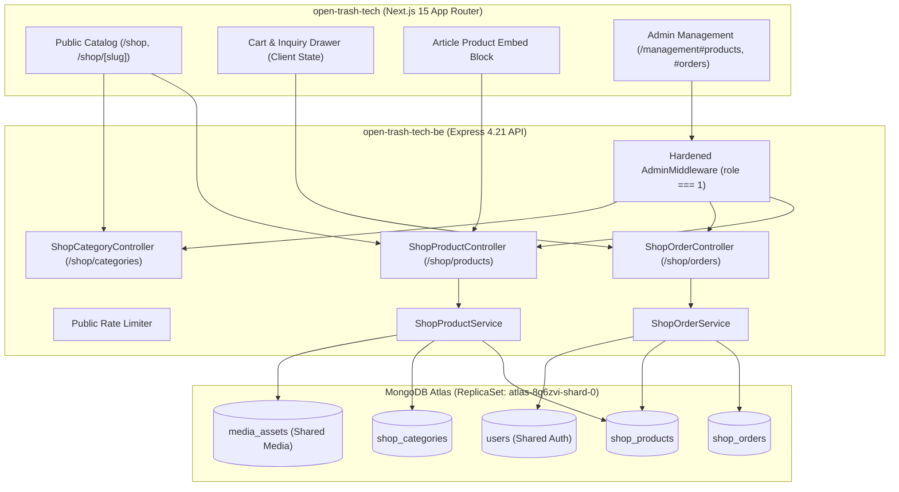
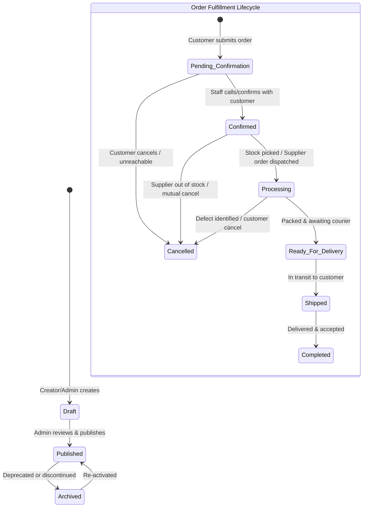

# OpenIdear Shop — Architecture Decisions (Sprint S0)

**Document Version:** 1.0.0  
**Date:** October 2026  
**Status:** Approved for Implementation Planning  
**Domain:** PC Hardware E-Commerce & Enthusiast Tech Catalog

---

## 1. Domain Architecture & Module Boundaries

OpenIdear Shop is designed as an autonomous, loosely-coupled domain within the existing OpenIdear ecosystem. It respects established conventions while strictly preventing cross-domain contamination with the existing **Editorial/Article** and **Course/Learning** domains.



### Module Boundaries
1. **Frontend:** Domain logic isolated in `src/features/shop/`:
   - `src/features/shop/components/`: Catalog, product card, filter sidebar, spec table, order submission modal.
   - `src/features/shop/store/`: `useShopCartStore` (Zustand client store stored in `localStorage`).
   - `src/features/shop/api/`: Typed Axios API methods calling backend `/shop/*`.
   - `src/features/shop/types/`: TypeScript interfaces for products, categories, orders, and specs.
2. **Backend:** Domain logic isolated in:
   - `controllers/shopProduct.controller.js` & `controllers/shopOrder.controller.js` & `controllers/shopCategory.controller.js`
   - `services/shopProduct.services.js` & `services/shopOrder.services.js` & `services/shopCategory.services.js`
   - `models/shopProduct.schema.js`, `models/shopCategory.schema.js`, `models/shopOrder.schema.js`

---

## 2. Data Ownership & Entity Relationship Design

### 2.1 Entity Relationship Diagram

```mermaid
erDiagram
    SHOP_CATEGORY ||--o{ SHOP_PRODUCT : "categorizes"
    SHOP_CATEGORY ||--o{ SHOP_CATEGORY : "sub-categorizes"
    SHOP_PRODUCT ||--o{ ORDER_ITEM_SNAPSHOT : "snapshotted into"
    SHOP_ORDER ||--|{ ORDER_ITEM_SNAPSHOT : "contains"
    SHOP_ORDER ||--|{ ORDER_EVENT_HISTORY : "tracks"
    USER ||--o{ SHOP_ORDER : "places (optional guest)"
    MEDIA_ASSET ||--o{ SHOP_PRODUCT : "provides images"

    SHOP_CATEGORY {
        ObjectId _id PK
        string name
        string slug UK
        string description
        string imageUrl
        ObjectId parentCategory FK
        int displayOrder
        boolean isActive
    }

    SHOP_PRODUCT {
        ObjectId _id PK
        string name
        string slug UK
        string sku UK
        ObjectId category FK
        string summary
        string description
        array images
        number sellingPrice
        number originalPrice
        string fulfillmentMode "stock | supplier_order | hybrid"
        string availabilityStatus "in_stock | available_on_order | out_of_stock | discontinued"
        int stockQuantity
        object supplierInfo
        array specifications
        string status "draft | published | archived"
        int views
        int orderCount
    }

    SHOP_ORDER {
        ObjectId _id PK
        string orderNumber UK
        ObjectId user FK "nullable for guests"
        object customerDetails
        object shippingAddress
        array items "embedded immutable snapshots"
        object totals
        string fulfillmentStatus "pending_confirmation | confirmed | processing | ready_for_delivery | shipped | completed | cancelled"
        string paymentStatus "unpaid | paid | refunded"
        string paymentMethod "cod | bank_transfer | manual_inquiry"
        string idempotencyKey UK
        array orderHistory "embedded audit events"
    }
```



### 2.2 Storage Decision: Separate Collections vs. Embedded Schemas
* **Separate Collections:**
  * `ShopCategory`: Independent hierarchy; high read-to-write ratio, cached aggressively.
  * `ShopProduct`: Primary catalog entities with high query volume, faceted search, and specs.
  * `ShopOrder`: High-value financial records with independent lifecycles and retention requirements.
* **Embedded Subdocuments:**
  * `order.items`: **MUST BE EMBEDDED IMMUTABLE SNAPSHOTS**. Never reference `ShopProduct` by live ID without capturing frozen values (`productName`, `sku`, `unitPrice`, `supplierSku`, `thumbnailUrl`). If a product price increases tomorrow, past orders must retain their historical contract price.
  * `order.orderHistory`: Embedded event log tracking every status transition (`fromStatus`, `toStatus`, `timestamp`, `actorId`, `note`). Orders typically undergo 3–6 state transitions, making an embedded array efficient with zero join overhead.

---

## 3. Product, Inventory & Order Lifecycle



### 3.1 Status Enums & Valid Transitions

1. **Fulfillment Mode:**
   - `stock`: In-house physical inventory. Stock must be decremented on order confirmation.
   - `supplier_order`: Sourced on-demand from authorized partner distributors. Availability displayed as *"Available on order (2–4 business days)"*. No immediate in-house stock decrement required.
   - `hybrid`: Base stock held, with backorder fulfillment possible when stock reaches zero.
2. **Availability Status:**
   - `in_stock`: Ready for same-day / next-day packaging.
   - `available_on_order`: Dispatched after distributor collection.
   - `out_of_stock`: Currently unavailable from all sources.
   - `discontinued`: End-of-life hardware.
3. **Fulfillment Status Transitions:**
   - `pending_confirmation` $\rightarrow$ `confirmed` | `cancelled`
   - `confirmed` $\rightarrow$ `processing` | `cancelled`
   - `processing` $\rightarrow$ `ready_for_delivery` | `cancelled`
   - `ready_for_delivery` $\rightarrow$ `shipped` | `cancelled`
   - `shipped` $\rightarrow$ `completed` | `cancelled` (return/failed delivery)
4. **Payment Status:**
   - `unpaid`: Initial state for manual order submission / COD / pending bank wire.
   - `paid`: Marked manually by admin upon reviewing bank statement / payment proof.
   - `refunded`: Returned goods or order cancelled after payment receipt.

---

## 4. Concurrency & Idempotency Strategy

### 4.1 Safe Inventory Decrement (Race-Condition Free)
In a flash sale or limited stock scenario (e.g. 5 graphics cards available), concurrent order submissions could oversell inventory.
We enforce single-document atomic operations with preconditions:

```javascript
// In ShopOrderService.js (execute inside order confirmation or checkout reservation)
const reservedProduct = await ShopProduct.findOneAndUpdate(
  {
    _id: item.productId,
    fulfillmentMode: { $in: ["stock", "hybrid"] },
    stockQuantity: { $gte: item.quantity },
    status: "published"
  },
  {
    $inc: { stockQuantity: -item.quantity }
  },
  { new: true }
);

if (!reservedProduct) {
  throw new ConflictException(
    `Product "${item.title}" does not have sufficient in-stock quantity.`
  );
}
```

### 4.2 Submission Duplicate Protection (`idempotencyKey`)
Network timeouts or impatient users double-clicking "Submit Order" can generate duplicate orders.
* The frontend client generates a `UUIDv4` `idempotencyKey` when the checkout form opens.
* The backend enforces a unique sparse index on `shop_orders.idempotencyKey`:
  ```javascript
  shopOrderSchema.index({ idempotencyKey: 1 }, { unique: true, sparse: true });
  ```
* If a duplicate key is submitted within 10 minutes, the backend intercepts the `E11000` duplicate key error and returns the previously created order object with an `X-Idempotent-Replay: true` header.

---

## 5. API Contracts & Specifications

### 5.1 Public APIs

#### `GET /shop/products`
* **Query Parameters:**
  * `category` (slug or ID)
  * `fulfillmentMode` (`stock` | `supplier_order`)
  * `availability` (`in_stock` | `available_on_order`)
  * `minPrice`, `maxPrice` (numbers in VND)
  * `sort` (`price_asc`, `price_desc`, `newest`, `popular`)
  * `page` (default 1), `limit` (default 20, max 100)
* **Response:**
  ```json
  {
    "success": true,
    "data": {
      "products": [
        {
          "_id": "6718fa...",
          "name": "NVIDIA GeForce RTX 4070 Super 12GB",
          "slug": "geforce-rtx-4070-super-12gb",
          "sku": "GPU-NV-4070S-12G",
          "category": { "name": "Graphics Cards", "slug": "graphics-cards" },
          "sellingPrice": 16990000,
          "originalPrice": 18500000,
          "fulfillmentMode": "stock",
          "availabilityStatus": "in_stock",
          "stockQuantity": 8,
          "thumbnail": "https://res.cloudinary.com/.../c_scale,w_400/v1/..."
        }
      ],
      "pagination": { "total": 45, "page": 1, "pages": 3, "limit": 20 }
    }
  }
  ```

#### `GET /shop/products/:slug`
* **Response:** Complete product detail, gallery images array, full specifications table, and category breadcrumb.

#### `POST /shop/orders`
* **Auth:** Optional (`req.userInfo` attached if user is logged in, supports guest checkout).
* **Payload:**
  ```json
  {
    "idempotencyKey": "550e8400-e29b-41d4-a716-446655440000",
    "customer": {
      "name": "Nguyen Van A",
      "phone": "0912345678",
      "email": "customer@example.com"
    },
    "shipping": {
      "address": "123 Tech Street, Ward 5",
      "district": "District 10",
      "city": "Ho Chi Minh City",
      "notes": "Call before delivering"
    },
    "paymentMethod": "bank_transfer",
    "items": [
      {
        "productId": "6718fa...",
        "quantity": 1
      }
    ]
  }
  ```
* **Security Rule:** The client **NEVER** supplies prices. The backend fetches authoritative prices from `ShopProduct` by `productId` and calculates subtotals server-side.

### 5.2 Admin APIs (Protected by Hardened `AdminMiddleware`)

* `POST /shop/admin/products`: Create new product (with SKU uniqueness check).
* `PATCH /shop/admin/products/:id`: Update product attributes, price, stock, specs.
* `DELETE /shop/admin/products/:id`: Soft delete (`del_flag: 1`) or archive.
* `GET /shop/admin/orders`: List customer orders with status, date, and customer filters.
* `GET /shop/admin/orders/:id`: Full order audit view.
* `PATCH /shop/admin/orders/:id/status`: Transition fulfillment/payment status with required reason/note.
* `POST /shop/admin/categories`: Category creation with icon and hierarchy.

---

## 6. Content-to-Commerce Integration (Non-Invasive Linking)

To maintain clean separation between editorial content and mutable commerce data:
1. **Never hardcode mutable prices or stock in article bodies.**
2. **Article Embed Block (`ProductCardBlock`):**
   * TipTap editor extension and `ArticleRenderer` block:
     ```json
     {
       "type": "product_card",
       "productId": "6718fa...",
       "displayStyle": "compact_card"
     }
     ```
   * When rendered by `src/features/article/components/ArticleRenderer.tsx`, the component fetches or renders the product's live selling price, availability badge, and direct "View in Shop" link.
   * If the product is later archived or deleted, the renderer degrades gracefully to an informational component or non-breaking mention without throwing an error.

---

## 7. Explicit Architecture Decisions & Trade-offs

| Decision | Chosen Option | Rejected Alternatives | Rationale & Trade-offs |
| :--- | :--- | :--- | :--- |
| **Domain Separation** | Dedicated `ShopProduct` & `ShopOrder` models | Reusing `Course` / `user.cart` | Physical goods have quantities, variations, shipping addresses, fulfillment modes, and delivery lifecycles incompatible with digital course enrollment. |
| **Checkout Flow** | High-touch Manual Order Confirmation (Phone/Zalo/Bank Transfer) | Immediate Online Gateway (Stripe/PayOS) for MVP | PC hardware orders have high average order value (AOV), rapid component price swings, and supplier availability fluctuations. Manual confirmation eliminates refund risks and builds customer trust early. |
| **Inventory Concurrency** | Atomic `$inc` with precondition query | Distributed locks (Redis) or full replica-set transactions | Avoids adding Redis infrastructure; atomic Mongoose updates are native, lightning-fast, and function reliably across both Atlas replica sets and local test runners. |
| **Media Storage** | Reuse existing `MediaAsset` + Cloudinary pipeline | Adding AWS S3 or Supabase Storage | Zero new vendors; Cloudinary pipeline already provides automated WebP transcoding, Sharp concurrency management, and responsive resizing. |
| **Cart Persistence** | Client `localStorage` via Zustand | Server-persisted Cart DB collection | Ephemeral hardware cart for unregistered guests. Minimizes database write amplification for abandoned carts. |

---

## 8. Unresolved Questions for Founders & Business Leads

1. **VAT & Invoice Requirements:** Does the MVP require issuing corporate e-invoices (Hóa đơn điện tử VAT) for business customers, or is personal retail invoice sufficient?
2. **Deposit Policy for Supplier-Fulfilled Products:** For expensive components ($1,000+ GPUs/CPUs) sourced on-demand from distributors, should OpenIdear require a partial bank wire deposit (e.g. 10%–20%) before placing the supplier order?
3. **Warranty & Return Terms:** What standard warranty duration and return policy window (e.g. 7-day replacement for manufacturer defects) will be displayed on the product detail page?
